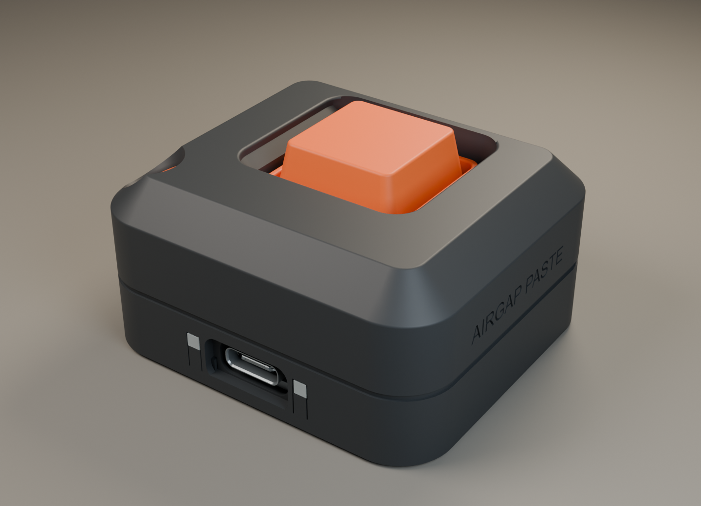
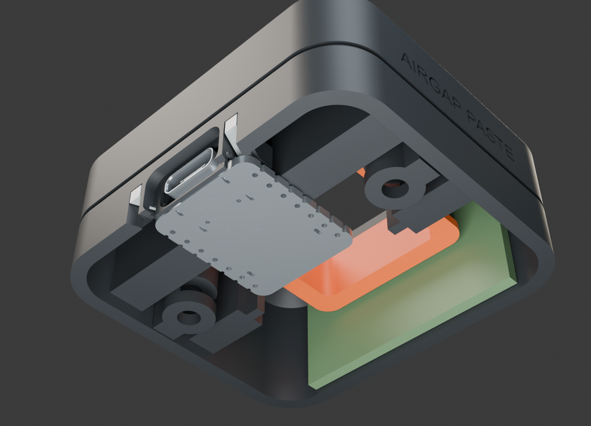
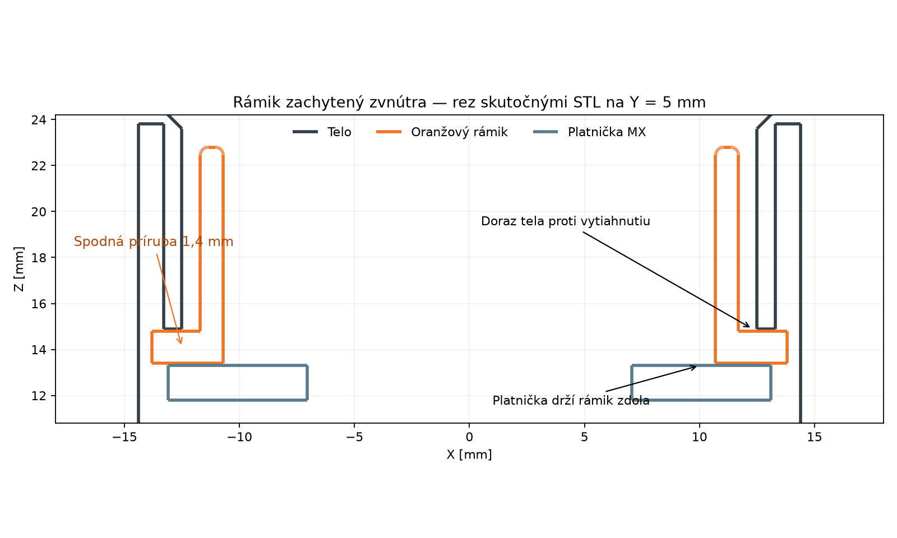

# AirGap Paste — Pocket Recess v6

Oprava podľa fyzického výtlačku v5: odlomili sa štíhle pridržiavače XIAO a oranžový rámik vypadával. V6 nahrádza pridržiavače stenovými rebrami a zachytáva rámik spodnou prírubou. Zacvaknutie Cherry MX a krížik krytky sú podľa používateľa vyhovujúce; ich finálne STL sú **identické s v5** (`preserved_interfaces.json`).

Telo má 54 × 48 × 26,6 mm, s krytkou 28,6 mm. V tejto oprave sa výška nemení. Korunka zachováva 5 mm vonkajšie skosenie, zaoblenie hrán a očko na krátku šnúrku. Nápis AIRGAP PASTE je na **pravom boku**, veľkosť 3,4 mm namiesto 2,5 mm, gravírovanie 0,45 mm do povrchu.

## Uchytenie XIAO

Štyri pôvodné dlhé pridržiavače s prierezom 1,5 × 2 mm sú odstránené. Dve nové 6 mm široké zvislé rebrá spájajú horné vedenie PCB s bočnou stenou a strechou. Krátke kontaktné rameno pri doske tak podopiera celá stena, nie voľný stĺpik. Podpery pri zámku zadného klina majú tiež široké spojenie s bočnou stenou; na strane koaxu zostáva priechod.

Spodné lišty sú široké 3,2 mm. Bočné dorazy sú nízke a široké 2,6 mm, predné dorazy sú širšie a majú zodpovedajúce vybranie v tele. Horná nominálna vôľa PCB zostáva 0,20 mm; bočná 0,21 mm. Zadný vyberateľný klin a jeho tesnejší/voľnejší variant zostávajú k dispozícii. Nezasúvaj dosku silou a nevytváraj predpätie skrutkami.

## Oranžový rámik zachytený zvnútra

Rámik 04 má spodnú prírubu 27,6 × 27,6 mm hrubú 1,4 mm. Vloží sa **z otvorenej spodnej strany tela pred platničkou MX**. Príruba presahuje 25 mm priechod o 1,3 mm na každej strane. Horný doraz tela bráni vytiahnutiu nahor a platnička MX s podperami dna drží rámik zdola. Nie je potrebné lepidlo ani pružné zacvakávacie háčiky. Výrezy v prírube musia smerovať ku koncom zadného klina.

Bočná vôľa sedla je 0,20 mm na stranu; súčet hornej a dolnej osovej vôle je 0,20 mm. Brim a prípadné výstupky odstráň pred montážou, aby príruba dosadla bez násilia. Po uzavretí nesmie rámik prejsť otvorom; pred uzavretím je zámerne vyberateľný smerom dole.

## Complete Test A1 a rozostupy

Platňa `00_complete_test_A1_PLA.3mf` obsahuje všetkých 9 dielov. Explicitné rozloženie má **minimálne 12 mm medzi pôdorysnými obálkami dielov v celej výške**, nie iba v prvej vrstve. Pri 4 mm brime a odstupe od dielu 0,15 mm zostáva konzervatívne minimálne 3,7 mm medzi obálkami brimov. Tlač je **po vrstvách** (`by layer`). Kontrola finálneho 3MF je v `complete_plate_spacing.json`.

Toto rozloženie je uložené v 3MF. Po jeho otvorení nepouži automatické rozloženie, ak chceš zachovať tieto odstupy. Mechanický Complete Test používa jeden PLA filament; funkčné svetlovody vytlač samostatne z priehľadného PLA. Všetky platne: Bambu Lab A1, tryska 0,4 mm, vrstva 0,10 mm, 3 steny, 20 % gyroid, podpery vypnuté.

| Súbor v `bambu_a1/` | Diely | Odhad min | PLA g |
|---|---:|---:|---:|
| `00_complete_test_A1_PLA.3mf` | 9 | 183.2 | 32.1 |
| `01_graphite_A1_PLA.3mf` | 3 | 160.2 | 28.15 |
| `02_orange_A1_PLA.3mf` | 4 | 32.4 | 3.74 |
| `03_clear_lightguides_A1_PLA.3mf` | 2 | 12.1 | 0.16 |
| `04_mx_fit_tests_A1_PLA.3mf` | 4 | 29.9 | 3.51 |
| `06_eyelet_fit_A1_PLA.3mf` | 2 | 29.3 | 1.57 |

STL bez `_assembly` sú pripravené na tlač na Z = 0. Telo sa tlačí korunkou nadol, krytka vrchnou stranou nadol, nový rámik **prírubou na podložke**, svetlovody čelnou stranou na podložke. Neotáčaj ich automaticky.

## Montáž

1. Očisti brim, dosadacie plochy, otvory skrutiek a kanály. Z v6 treba znovu vytlačiť **telo 01, dno 02 a rámik 04**. Krytku, platničku MX, klin, svetlovody a vložku očka môžeš použiť z v5, ich finálne STL sú identické. Finálne telo, dno a rámik používaj spoločne z **v6**; staré telo nemá sedlo pre novú prírubu.
2. Vlož dve matice M3 do bočných kapsičiek tela. Vlož rámik 04 **zospodu**, zarovnaj dva bočné výrezy s podperami klina a posuň ho k dorazu.
3. Do nezmenenej 1,50 mm platničky 05 zacvakni svoj Cherry MX. Vlož ju so spínačom zospodu pod prírubu rámika. Piny smerujú dozadu. Platničku podopierajú štyri pôvodné podpery dna.
4. Svetlovody vlož zospodu do kanálov; nelep ich na LED. Ľavý je nad CHG0, pravý nad používateľskou D3. Jas treba overiť s priehľadným výtlačkom.
5. XIAO polož na spodné lišty, USB dopredu. Vlož zadný klin bez prehnutia PCB. Tenké vodiče MX veď mimo oporných plôch dosky a koaxu; STEP dosky nemodeluje tvoje spájkované vodiče. Konektor antény pripájaj kolmo, nezaťažuj ho ťahom.
6. Anténu Seeed A-02 prichyť naplocho na zadnú XZ stenu; neskladaj FPC. Nominálna obálka je 37,8 × 17,9 × 1,8 mm. Over voľné vedenie koaxu cez určený bočný priechod.
7. Zatvor telo s dnom dvoma zápustnými M3 × 10, jemne bez deformácie PLA. Nasaď pôvodnú krytku 03. Over celý 4 mm zdvih, návrat, zachytenie rámika a USB.
8. Po skúške nasaď/prilep malú vložku **09 očka na šnúrku**. Táto vložka stále používa lepidlo; rámik **04 pri tlačidle ho nepotrebuje**. Navleč ohybnú šnúrku do 2 mm cez šikmé horné očko a krátky bočný priechod. Kovový krúžok pripoj ku šnúrke.

Po montáži skús opakovane zapojiť/vytiahnuť svoj USB kábel: PCB sa nesmie posúvať ani prehýbať. Pevnosť nových rebier a tolerancie príruby treba potvrdiť novým výtlačkom. CAD ani slicer nedokazujú odolnosť proti lámaniu.

## Overenie a hranice

- 197 CAD kontrol vybraných kolízií a montážnych polôh: všetky 0 mm³ v numerickej tolerancii. Zahŕňajú páry všetkých tlačených dielov, vloženie rámika zospodu, elektroniku, svetlovody, skrutky, zasunutie matíc a zdvih krytky 0 / 2 / 4 mm.
- Dve pozitívne kontroly dorazov rámika: pokus o posun o 0,5 mm nahor narazí na telo a nadol na platničku MX. Ide o geometriu zachytenia, nie skúšku pevnosti.
- 9 hlavných dielov: jeden platný CAD solid, uzavretá mesh, 0 nemanifold hrán v Blenderi.
- 6 naslicovaných 3MF: správne počty dielov, jedna platňa, bez upozornení a dráh podpier. Finálne modely sa porovnávajú so STL pri balení.
- Skontrolované skutočné Blender rendery a dráhy tela v šiestich výškach; nominálna dvojitá šnúrka bez kolízie.
- Používateľ fyzicky potvrdil MX zacvaknutie a krížik krytky vo v5; tieto diely sú identické. **Nové uchytenie XIAO a príruba v6 ešte fyzicky overené nie sú.** Rozmer konkrétneho USB kábla, vodiče, jas LED, dosah Bluetooth a odolnosť pri páde zostávajú fyzické skúšky.

## Zdroj a regenerovanie

PCB 17,78 × 20,955 × 1,25 mm vychádza z oficiálneho Seeed STEP v `reference/XIAO_ESP32S3_Seeed.step`. LED polohy pochádzajú z pribaleného `XIAO_official.kicad_pcb`; STEP malé LED neobsahuje. Referenčné výkresy antény a MX sú pribalené. Konceptový obrázok neurčuje výrobné rozmery.

`build_pocket_recess.py` vytvorí CAD/STL a kontroluje montáž. Potom spusti `make_eyelet_coupon.py`, `verify_cord_path.py`, `make_halo_section.py`, `render_pocket_recess.py` v Blenderi, `prepare_a1.py`, `inspect_toolpaths.py` a `package_delivery.py`. `prepare_a1.py` používa lokálne macOS Bambu Studio a `spread_complete_plate.py` nastavuje rozloženie Complete Test; modely nemení. Na inom systéme uprav cestu aplikácie.

Dodané STEP a Blender sú editovateľné. Súbory `_assembly.stl` sú v montážnej polohe. Staršie revízie sú v samostatných priečinkoch.
