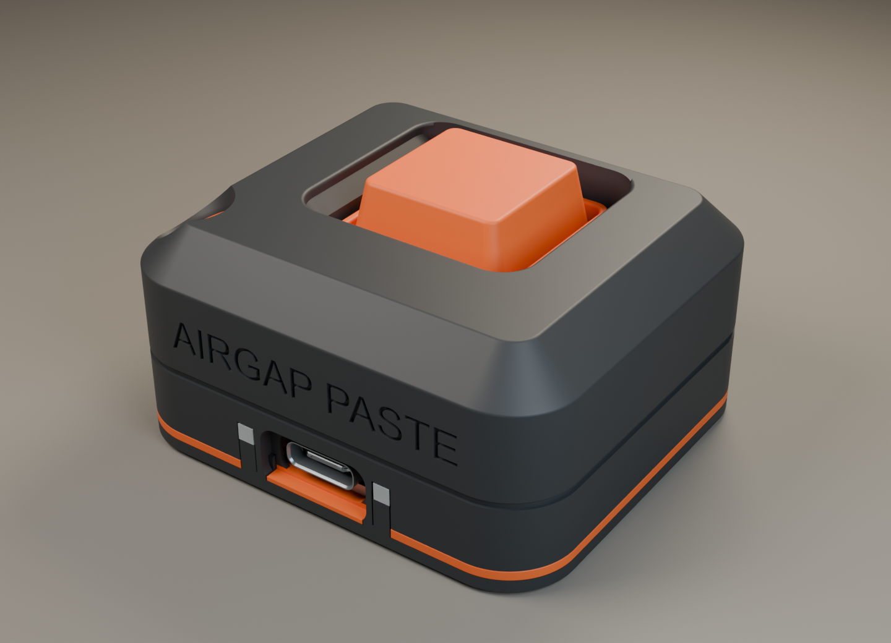
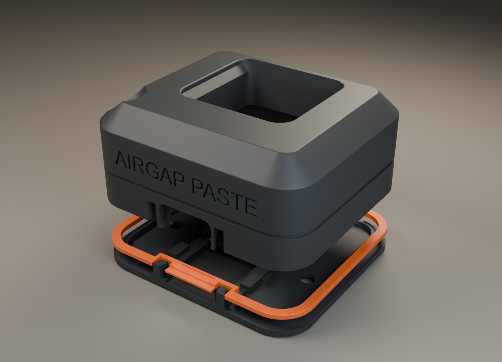
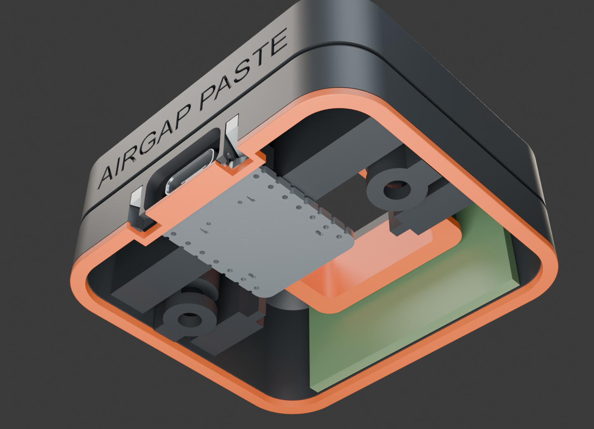
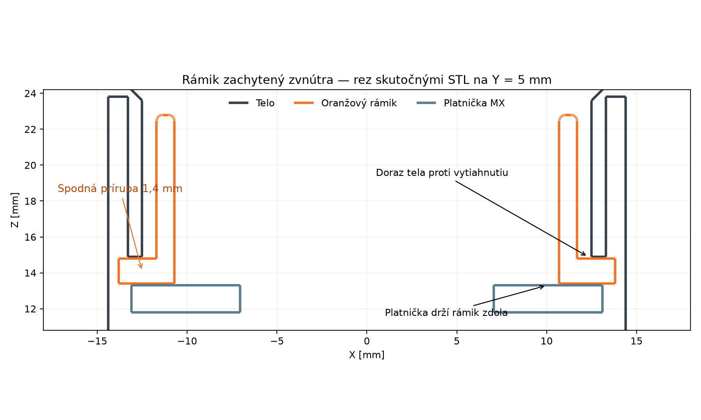

# AirGap Paste — Pocket Recess v7

Finálny návrh: **oranžová obruba priamo v spoji horného a spodného dielu**, zarovno s bokmi. Je samostatným tretím dielom krytu, vysokým 1,2 mm. Zasahuje do vybrania v oboch čiernych dieloch a je zachytená ich zatvorením; nepotrebuje lepidlo ani ďalšie skrutky. Má vnútorný mostík a vybrania pri pôvodných oporách svetlovodov/PCB. Spredu preto oranžový pásik obchádza opory LED; po bokoch a vzadu je súvislý.

Nápis **AIRGAP PASTE je nad USB**: skutočná šírka 36,8 mm, veľkosť písma približne 5,12 mm, gravírovanie 0,45 mm. Jednoriadkový nápis využíva rovnú časť predného čela s rezervou 0,6 mm pri každom rohu.

Telo má **54 × 48 × 26,6 mm**, s krytkou celá zostava **54 × 48 × 28,6 mm**. Obruba nezväčšuje pôdorys ani výšku. Zostávajú **2× M3 × 10 so zápustnou hlavou a 2× M3 DIN 934**. Vnútorné polohy PCB, MX platničky, matíc a skrutiek zostali zachované.

## Vytlač celú zostavu na farebných platniach

1. **Čierne diely:** `01_graphite_A1_PLA.3mf` — telo 01, dno 02, klin XIAO 07.
2. **Oranžové diely:** `02_orange_A1_PLA.3mf` — krytka 03, zachytený rámik tlačidla 04, platnička MX 05, vložka očka 09, obruba spoja 12.
3. **Priehľadné diely:** `03_clear_lightguides_A1_PLA.3mf` — dva svetlovody 06; podľa potvrdenia používateľa zostávajú na samostatnej malej platni pre priehľadné PLA.

Spolu 10 tlačených dielov. Čierna a oranžová platňa sa tlačia samostatne, AMS nie je potrebný. Všetky tri hlavné platne majú uložené rozloženie s **minimálne 12 mm medzi pôdorysnými obálkami dielov v celej výške**. Pri zapnutom 4 mm brime a medzere 0,15 mm zostáva konzervatívne minimálne 3,7 mm medzi obálkami brimov. Oranžová platňa brim nepoužíva. Tlač je po vrstvách (`by layer`). Ak chceš rozostupy zachovať, po otvorení 3MF nepouži automatické rozloženie.

Profily sú pre **Bambu Lab A1 / tryska 0,4 mm / PLA / 0,10 mm vrstvy / 3 steny / 20 % gyroid / bez podpier**. Časy a hmotnosti sú odhady slicera.

| Súbor v `bambu_a1/` | Diely | Min | PLA g |
|---|---:|---:|---:|
| `00_complete_test_A1_PLA.3mf` | 10 | 187.8 | 32.56 |
| `01_graphite_A1_PLA.3mf` | 3 | 159.1 | 27.99 |
| `02_orange_A1_PLA.3mf` | 5 | 35.5 | 4.29 |
| `03_clear_lightguides_A1_PLA.3mf` | 2 | 12.1 | 0.16 |
| `04_mx_fit_tests_A1_PLA.3mf` | 4 | 29.9 | 3.51 |
| `06_eyelet_fit_A1_PLA.3mf` | 2 | 29.3 | 1.57 |
| `07_seam_trim_A1_PLA.3mf` | 1 | 10.8 | 0.61 |
| `08_base_upgrade_A1_PLA.3mf` | 1 | 42.3 | 6.45 |

STL bez `_assembly` sú v tlačovej orientácii, so spodkom Z = 0. Telo sa tlačí korunkou nadol, dno spodkom nadol, rámik tlačidla svojou prírubou a obruba spoja širokou spodnou plochou na podložke. Krytka sa tlačí vrchnou stranou nadol. Neotáčaj ich automaticky.

Platňa 00 je voliteľný jednofarebný mechanický Complete Test všetkých 10 dielov; svetlovody z nepriehľadného PLA nenahradia funkčné priehľadné. Ostatné malé platne sú samostatné testy alebo diely; na celé farebné zariadenie použi platne **01 + 02 + 03**.

## Montáž

1. Očisti brim a dosadacie plochy. **Obrubu 12 nasuň na prázdne dno 02 zhora ešte pred vložením elektroniky.** Predný vnútorný mostík a dve vybrania patria k USB/svetlovodom; horné vybranie pod USB musí smerovať nahor.
2. Do tela 01 vlož matice M3. Oranžový rámik tlačidla 04 vlož **zvnútra**, jeho výrezy zarovnaj s podperami zadného klina. Zachytí sa prírubou, bez lepidla.
3. Cherry MX zacvakni do nezmenenej 1,50 mm platničky 05, piny dozadu. Vlož ju zospodu pod rámik; po uzavretí ju podopierajú štyri podpery dna.
4. Priehľadné svetlovody vlož zospodu do kanálov tela. Ľavý je nad CHG0, pravý nad používateľskou LED D3. Nedávaj lepidlo na LED ani na dosku.
5. XIAO polož na spodné lišty s USB dopredu. Vlož zadný klin bez prehnutia PCB. K dispozícii sú tesnejší/voľnejší variant s rozdielom 0,10 mm. Vodiče MX veď mimo dosadacích plôch; tvoje spájkované vodiče nie sú v Seeed STEP modeli.
6. Anténu Seeed A-02 ulož naplocho na zadnej XZ stene; FPC neskladaj. Koax veď bočným priechodom bez ostrého zalomenia a ťahu za u.FL.
7. Prilož telo a zatvor dve M3 × 10 jemne. Obruba má dosadnúť vo vybraniach a zachytiť sa medzi dielmi. Nasaď krytku a over celé 4 mm stlačenie aj voľný návrat. Skús USB kábel: PCB sa nesmie posúvať ani prehýbať.
8. Malú vložku **09 očka na šnúrku** po skúške prilep v šikmom sedle. Táto vložka stále používa lepidlo; rámik tlačidla 04 a obruba spoja 12 ho nepotrebujú. Ohybnú šnúrku do 2 mm navleč horným očkom a krátkym bočným výstupom; kovový krúžok pripoj ku šnúrke.

Používaj spolu nové telo, dno a obrubu v7. Predchádzajúce čierne diely nemajú kompletné vybranie pre obrubu v spoji.

## Uchytenie elektroniky a tlačidla

XIAO má dve 6 mm široké rebrá spojené s bočnou stenou a strechou. Pôvodné štíhle pridržiavače sú odstránené. Spodné lišty a nízke bočné dorazy, predné dorazy a široko podopreté ramená klina zostávajú súčasťou zosilnenia v6. Uloženie PCB má hornú návrhovú vôľu 0,20 mm a bočnú 0,21 mm.

Rámik tlačidla 04 má spodnú prírubu 27,6 × 27,6 × 1,4 mm, vloženú medzi doraz tela a platničku MX. Nie je spojený s novou obrubou 12. Zacvaknutie MX a krížik krytky sú identické s používateľom overenou v5. Krytka, rámik tlačidla, MX platnička, klin, svetlovody a vložka očka majú identické STL s v6 (`preserved_interfaces.json`).

## Overenie a hranice

- 222 CAD kontrol vybraných kolízií a montážnych polôh: všetky 0 mm³ v numerickej tolerancii. Zahŕňajú všetky páry tlačených dielov, elektroniku, svetlovody, matice, MX zdvih a nasúvanie obruby na prázdne dno.
- Štyri pozitívne kontroly dorazov: posun rámika alebo obruby o 0,5 mm nahor/nadol narazí na zachytávajúce diely. Ide o geometriu zachytenia, nie skúšku sily.
- 10 hlavných dielov má jeden platný CAD solid, jednu uzavretú mesh a 0 nemanifold hrán v Blenderi.
- 8 pripravených 3MF sa naslicovalo bez upozornení a podpier, so správnymi počtami dielov. Balík porovnáva finálne modely so STL a kontroluje SHA-256 manifest.
- Finálne renderované CAD pohľady a dráhy v šiestich výškach sú vizuálne skontrolované. Rozostupy hlavných platní sú zmerané z finálnych 3MF.
- Používateľ potvrdil MX zacvaknutie a krytku v predchádzajúcom výtlačku. **Uchytenie XIAO z v6 a finálne telo/dno/obruba v7 ešte nemajú fyzické overenie.** Skutočný USB kábel, vodiče, dosadnutie obruby, pevnosť, jas LED a dosah Bluetooth treba potvrdiť výtlačkom.

## Zdroje a regenerovanie

XIAO vychádza z oficiálneho Seeed STEP; PCB 17,78 × 20,955 × 1,25 mm. LED polohy sú z `reference/XIAO_official.kicad_pcb`; STEP ich neobsahuje. Referenčné výkresy antény a MX sú pribalené. Návrhová obálka FPC je 37,8 × 17,9 × 1,8 mm. Konceptový obrázok neurčuje výrobné rozmery.

Regeneruj postupne: `build_pocket_recess.py`, `make_eyelet_coupon.py`, `verify_cord_path.py`, `make_halo_section.py`, `render_pocket_recess.py` v Blenderi, `prepare_a1.py`, `inspect_toolpaths.py`, `package_delivery.py`. `prepare_a1.py` používa lokálne Bambu Studio na macOS a `spread_complete_plate.py` na explicitné rozloženie hlavných platní. Na inom systéme uprav cestu aplikácie.

STEP, STL a Blender patria k finálnej v7. `_assembly.stl` sú v montážnej polohe. Staršie revízie zostávajú samostatne.
