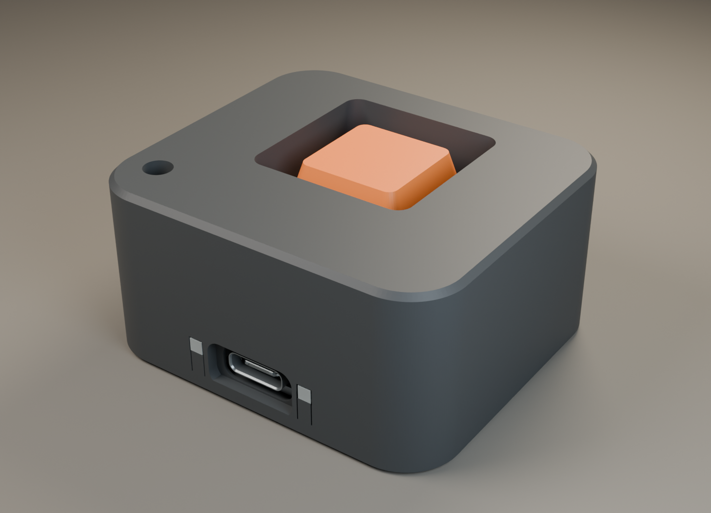
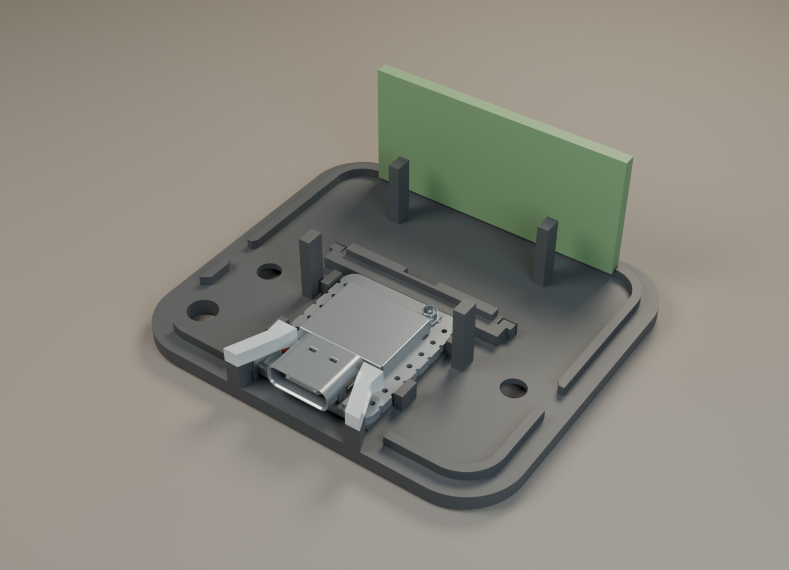

# AirGap Paste — Pocket Recess

Vybraný návrh č. 2: zaoblená grafitová krabička s oranžovým zapusteným tlačidlom. Vonkajší rozmer **54 × 48 × 26,6 mm**, zaoblenie rohov 8 mm. Tlačidlo je v pokoji 1 mm pod horným okrajom; má priestor na plný 4 mm zdvih MX. Zapustenie znižuje náhodné stlačenie vo vrecku, nie je to mechanický zámok.

## Čo sa zmestí

- Seeed Studio XIAO ESP32-S3 **bez pinových líšt**, so štandardným USB-C na doske.
- Jeden štandardný 3-pin MX spínač a dodaná tlačená krytka.
- Seeed A-02 externá FPC anténa 2,4 GHz, uložená naplocho na zadnej stene. Návrhová obálka 37,8 × 17,9 × 1,8 mm zahŕňa rezervu.
- Dva samostatné svetlovody pre existujúce LED dosky, vyvedené vedľa USB.
- Tenké vodiče spínača, vedené popri boku mimo anténneho koaxu.

Bez batérie a displeja. Na uzavretie sú potrebné **2 skrutky M3 × 10 so zápustnou hlavou a 2 matice M3 DIN 934**. Farebné diely sa dajú tlačiť oddelene bez AMS.

## Najprv vytlač malý test

Otvor `bambu_a1/04_mx_fit_tests_A1_PLA.3mf` v Bambu Studio: približne **25 min / 2,72 g**. Obsahuje tri otvory 14,0 / 14,1 / 14,2 mm v doske hrubej 1,5 mm a finálnu krytku. Skontroluj zacvaknutie svojho spínača, uchytenie krížika, úplný zdvih a voľný návrat.

Finálna montážna platnička používa otvor **14,1 mm**. Ak konkrétny spínač lepšie sedí v inom testovacom otvore, uprav hodnotu v `build_pocket_recess.py`, znovu vytvor CAD a naslicuj platničku. Testovací štvorček nenahrádza montážnu platničku v krabičke.

## Pripravené platne pre Bambu Lab A1

PLA, tryska 0,4 mm, 3 steny, 20 % gyroid, vypnuté podpery. Časy a hmotnosti sú odhady slicera pre dodané profily.

| Súbor v `bambu_a1/` | Diely | Vrstva | Čas | PLA |
|---|---|---:|---:|---:|
| `00_complete_test_A1_PLA.3mf` | všetkých 8 dielov na mechanický test | 0,10 mm | 156 min | 27,64 g |
| `01_graphite_A1_PLA.3mf` | telo, dno, klin XIAO | 0,20 mm | 87 min | 26,43 g |
| `02_orange_A1_PLA.3mf` | krytka, spodný lem, platnička MX | 0,10 mm | 21 min | 1,75 g |
| `03_clear_lightguides_A1_PLA.3mf` | ľavý a pravý svetlovod | 0,10 mm | 12 min | 0,16 g |
| `04_mx_fit_tests_A1_PLA.3mf` | tri testy MX a krytka | 0,10 mm | 25 min | 2,72 g |

Pre funkčné LED vytlač svetlovody z **priehľadného PLA**. Jednofarebná nepriehľadná platňa 00 slúži na overenie mechaniky. Jas a účinnosť tlačeného svetlovodu zatiaľ nie sú fyzicky zmerané.

STL bez prípony `_assembly` už majú pripravenú tlačovú orientáciu a spodok na Z = 0. Telo sa tlačí hornou stranou na podložke, krytka vrchnou plochou nadol, svetlovody čelnou plochou na podložke. Klin leží na širokej strane. Na malých dieloch a grafitovej platni je pripravený 4 mm brim. Odstráň ho opatrne.

Neotáčaj telo pri importe STL automaticky. Platnička MX potrebuje 0,10 mm vrstvy, aby vyšla jej navrhnutá hrúbka 1,50 mm. Krátke mosty v kanáloch LED a kapsách matíc zostávajú súčasťou návrhu bez podpier.

## XIAO a USB

Doska leží na dvoch spodných lištách; predné dorazy sa opierajú o okraj PCB pri USB a vyberateľný zadný klin obmedzuje pohyb opačným smerom. Bočné opory a horné pridržiavače vedú dosku pri manipulácii s káblom. Opory sa neopierajú o USB puzdro, tlačidlá, RF kryt ani konektor antény.

Nominálna vôľa je 0,21 mm na každom boku, 0,20 mm nad PCB, 0,15 mm vpredu a 0,20 mm pri zadnom kline. Pribalené sú aj `07_wedge_tighter.stl` a `07_wedge_looser.stl` s rozdielom 0,10 mm na zadnej vôli. Zvoľ klin podľa prvého výtlačku; doska musí sedieť bez prehýbania. Prípadnú zvyšnú vôľu vyplň tenkou poddajnou izolačnou podložkou pri okraji PCB, mimo súčiastok a spájkovaných kontaktov.

Čelo USB je zapustené približne 1,26 mm. Vnútorný otvor má 11,5 × 5,2 mm a vonkajšie rozšírenie 14 × 7 mm. Pri skúške over plné zasunutie svojho kábla; rozmery plastových hláv káblov sa líšia. Krabička podopiera PCB, odolnosť samotného spájkovaného USB konektora závisí od dosky.

## LED a anténa

Pri pohľade spredu na USB je ľavý svetlovod nad **červenou nabíjacou LED CHG0**, pravý nad **žltou používateľskou LED D3**. Existujúci firmware používa používateľskú LED na GPIO 21, aktívnu v LOW. Nabíjacia LED nie je druhá programovateľná stavová LED; bez batérie od nej nepredpokladaj stavové blikanie. Zapojenie spínača v existujúcom firmvéri je D1 / GPIO 2 a GND.

Svetlovody majú vlastné kanály otvorené smerom ku dnu. Zberné konce sú nad skutočnými pozíciami LED; medzi modelovaným vrchom LED a svetlovodom zostáva približne 0,65 mm. Neskracuj ich naslepo a nelep ich na dosku. Po skúške môžeš malou kvapkou číreho lepidla upevniť iba spoj svetlovodu s plastovým kanálom alebo prednou kolískou.

Anténa zostáva **plochá**, prichytená tenkou lepiacou vrstvou na zadnej stene. Koax veď vo vyhradenom bočnom priestore, bez ostrého zalomenia; vodiče MX po opačnej strane. Otvor na šnúrku je vpredu, mimo antény. Konektor u.FL pripájaj kolmo a nezaťažuj ťahom kábla.

## Montáž

1. Vytlač test MX. Odstráň brim a skontroluj čisté otvory, kanály a dosadacie plochy.
2. Do bočných kapsičiek tela vlož dve matice M3. Oranžový spodný lem vlož do priehlbiny; po skúške ho môžeš uchytiť malou kvapkou lepidla.
3. Spínač zacvakni do samostatnej platničky MX, jeho spodné piny smerujú dozadu. Platničku so spínačom vlož do tela z otvorenej spodnej strany. Dno ju po uzavretí podopiera štyrmi stĺpikmi.
4. Svetlovody vlož zospodu do ich kanálov. Najprv ich nechaj bez lepidla.
5. XIAO polož na lišty dna s USB smerom dopredu. Vlož zadný klin; over vôľu a podľa potreby zvoľ tesnejšiu/voľnejšiu verziu. Pripoj a ulož anténu a vodiče MX.
6. Zostavu spoj so zatiaľ voľným telom. Over, že svetlovody sedia nad LED, koax a vodiče sa nepricviknú a krytka má celý zdvih. Doska sa nesmie prehýbať.
7. Zatvor dve skrutky M3 × 10 jemne, bez deformovania PLA. Nasaď krytku. Vyskúšaj zapojenie/vytiahnutie USB, tlačidlo a stavovú LED. Až po úspešnej skúške prípadne fixuj svetlovody a lem.

## Čo bolo overené

- 136 CAD kontrol vybraných kolízií a montážnych dráh: prienik 0 mm³. Zahŕňajú elektroniku, 0 / 2 / 4 mm zdvih krytky, vloženie svetlovodov a bočné zasunutie matíc.
- Všetkých 8 hlavných tlačených dielov tvorí jeden platný CAD solid a jednu uzavretú mesh; Blender hlási 0 nemanifold hrán.
- Päť finálnych 3MF archívov je nepoškodených a obsahuje modely aj G-code. Bambu Studio 02.08.02.61: A1 / 0,4 mm, jedna platňa na súbor, správny počet dielov, žiadne upozornenia a žiadne dráhy podpier.
- Skontrolované rendery finálneho Blender modelu a reálne dráhy tela v šiestich výškach (`toolpath_inspection.png`).

**Fyzický výtlačok zatiaľ nebol overený.** Rozmer konkrétneho MX klonu a jeho krížika, vôľa USB, jas LED, návrat tlačidla, pevnosť pri páde a dosah Bluetooth vyžadujú skúšku s tvojimi dielmi. Slicovanie ani CAD kontrola tieto skúšky nenahrádzajú.

## Zdroje a editovateľné súbory

- Mechanika XIAO vychádza z oficiálneho Seeed STEP `reference/XIAO_ESP32S3_Seeed.step`: PCB 17,78 × 20,955 × 1,25 mm. [Seeed dokumentácia a CAD/PCB odkazy](https://wiki.seeedstudio.com/xiao_esp32s3_getting_started/).
- STEP neobsahuje malé LED. Pozície sú z footprintov CHG0 a D3 v pribalenom `reference/XIAO_official.kicad_pcb`, stiahnutom cez Seeed wiki. Odkaz označený v1.4 poskytol archív Sense v1.5; zarovnanie referenčných tlačidiel so STEP vyšlo približne do 0,1 mm. Zhoda LED konkrétnej revízie sa overí pri montáži.
- [Oficiálny datasheet Seeed A-02 FPC antény](https://files.seeedstudio.com/wiki/XIAO_WiFi/antenna/FPC_Antenna_2.4GHz_1.16dbi_for_XIAO_ESP32S3/res/Datasheet_2.4GHz_FPC_Antenna_1.16dbi_for_XIAO_ESP32S3.pdf): menovitý pôdorys 37,4 × 17,5 mm; návrh používa uvedenú väčšiu obálku.
- [Výkres štandardného MX spínača Gateron](https://www.gateron.com/u_file/2404/12/file/GATERONMelodicSwitch-KS-61BFH10B060NW-D165.pdf) určuje pracovnú obálku: horné puzdro 6,6 mm nad platničkou a zdvih 4 mm. Ide o rozmerový referenčný model, nie certifikáciu konkrétneho MX klonu; stredový otvor puzdra je aproximovaný na 6 × 6 mm.

`pocket_recess_assembly.step` obsahuje tlačené diely, `pocket_recess_with_electronics.step` aj dosku a obálky elektroniky. `pocket_recess_assembly.blend` obsahuje finálnu zostavu v metrických jednotkách. Súbory `_assembly.stl` sú v montážnej polohe a neslúžia na priamu tlač.

Regenerovanie CAD: vytvor Python prostredie, nainštaluj `requirements.txt` a spusti `python build_pocket_recess.py`. Rendery: `blender --background --python render_pocket_recess.py`. Platne: `python prepare_a1.py` používa nainštalované Bambu Studio na macOS a pribalené profily; na inom systéme uprav cestu k aplikácii. `python inspect_toolpaths.py` vykreslí vložený G-code.

`selected_concept.png` je pôvodný vizuálny koncept. Rozmery na výrobu určujú STEP/STL a `validation.json`, nie konceptový obrázok. Finálny model je vyšší, aby poskytol správnu vôľu štandardnému MX a ploché miesto anténe.
